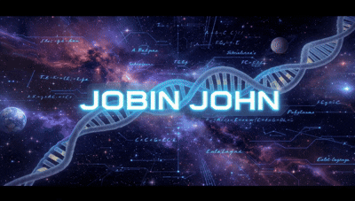

  

---
---

## Contact

---

## Technical Skills

| Category | Technologies / Tools |
| :--- | :--- |
| **Languages** |     |
| **Bioinformatics** |   |
| **AI / ML** |        |
| **Databases** |    |
| **Security** |    |
| **Cloud & DevOps** |     |

---

## Current Projects

### Histopath_Agent
> An AI system that pairs a convolutional vision model for tissue-scan risk classification with a language-generation layer. The second component translates the model's output into a readable clinical summary, addressing both the detection challenge and the barrier to clinical adoption.

  

### Cloud Cost Optimizer
> A SaaS platform that connects securely to a company's AWS account, identifies wasted spend in idle or oversized resources, and converts its findings into clear, actionable savings recommendations. It is being developed as a production product, with billing integrated from the outset rather than as a portfolio demonstration.

  
