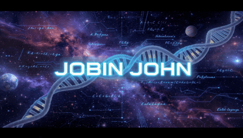

  

## Contact 

  
  
  
  
  
  

## Technical Skills

| Category | Technologies / Tools |
| :--- | :--- |
| **Languages** |     |
| **Bioinformatics** |   |
| **AI / ML** |        |
| **Databases** |    |
| **Security** |    |
| **Cloud & DevOps** |     |

---

## Current Projects

### Histopath_Agent
> An AI-powered system that analyzes medical tissue scans for potential health risks identification. Using computer vision to detect patterns in tissue scans while a clinical summary is generated via a language generation model.

  

### Cloud Cost Optimizer
> A SaaS platform that connects securely to a company's AWS account, identifies wasted spend in idle or oversized resources, and converts into finding ways to reduce cloud costs. It is being developed as a production product, with Stripe integration to manage subscriptions, billing, and payments

  
